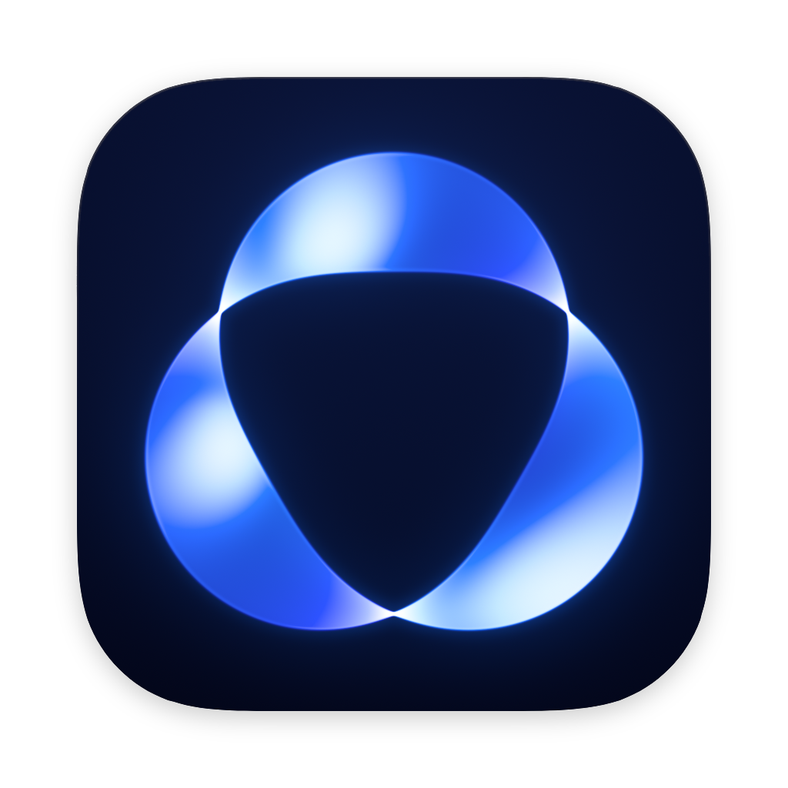

<p align="center">
  
</p>

<h1 align="center">Tempo</h1>

<p align="center">A desktop app for coding agents, built on <a href="https://github.com/pingdotgg/t3code">T3 Code</a>.<br>It runs Claude Code and Codex on your own Mac, on your own sign-ins.</p>

## Install

1. Download `Tempo-<version>-arm64.dmg` from the [latest release](../../releases/latest). It runs on Macs with Apple silicon.
2. Open the disk image and drag Tempo to Applications.
3. The app is not signed or notarized, so the first time you open it macOS says it cannot verify the developer. Open System Settings, then Privacy & Security, and press Open Anyway next to Tempo. You can also clear the quarantine flag:

   ```bash
   xattr -dr com.apple.quarantine /Applications/Tempo.app
   ```

4. On first launch, the welcome wizard offers a Sign in button for each agent.

Each release lists the disk image's SHA-256 in `SHA256SUMS.txt`. To check a download, run `shasum -a 256 Tempo-<version>-arm64.dmg` and compare. Tempo does not update itself: to update, download the newer disk image and replace the app.

## Signing in

Tempo uses each agent's own sign-in on your Mac. Claude runs on Claude Code's login (`claude auth login`), and Codex runs on its own login (`codex login`). The Sign in button opens a terminal that runs the login command.

Tempo has no hosted service of its own and sends no telemetry. It downloads the public files it needs from their publishers: the model list from GitHub, agent updates from npm and the agents' release servers, and the browser's components from Google and the Chrome Web Store. T3 Connect, the hosted web app and update feeds stay off unless a build names its own (see [`.env.example`](.env.example)).

## Building from source

Tempo uses T3 Code's toolchain. Install [Vite+](https://viteplus.dev/guide/) for the `vp` command, a Rust toolchain and the Xcode Command Line Tools, then run these commands at the repository root:

```bash
vp i                            # install dependencies
vp run dev                      # run the server and web app from source
vp run dist:desktop:dmg:arm64   # build the macOS app for Apple silicon into release/
```

A build has no update feed unless `T3CODE_DESKTOP_UPDATE_REPOSITORY` names a GitHub repository whose releases it should update from (a build in GitHub Actions uses that run's repository when it is unset). To update, build again and replace the app.

## Runs beside T3 Code

Tempo installs and runs beside the official T3 Code on the same machine without sharing state:

|                     | Tempo                                                | T3 Code                                        |
| ------------------- | ---------------------------------------------------- | ---------------------------------------------- |
| App name            | Tempo                                                | T3 Code                                        |
| Desktop app id      | `local.tempo.app`                                    | `com.t3tools.t3code`                           |
| URL schemes         | `tempo://`, `tempo-dev://`                           | `t3code://`, `t3code-dev://`                   |
| CLI                 | `tempo`                                              | `t3`                                           |
| Data home           | `~/.tempo` (`TEMPO_HOME` or `T3CODE_HOME` overrides) | `~/.t3`                                        |
| Background service  | `local.tempo.app.service`, `tempo.service`           | `com.t3tools.t3code.service`, `t3code.service` |
| Default server port | 3873                                                 | 3773                                           |
| Worktree branches   | `tempo/…`                                            | `t3/…`                                         |

If you set `T3CODE_HOME` for T3 Code, set `TEMPO_HOME` as well so Tempo keeps its own data. `TEMPO_HOME` wins when both are set. Thread links keep T3 Code's `t3-thread://` format.

## Staying current with T3 Code

Tempo takes T3 Code's stable release tags (`vX.Y.Z`) by applying upstream's diff three-way instead of merging, so it works in a repository that has none of T3 Code's history. [`t3code-upstream.json`](./t3code-upstream.json) records the last tag synced. To take the next one, run `vp run sync:upstream --to <stable tag>` on a new branch, then follow [Pulling T3 Code stable releases](./docs/operations/tempo-t3-stable-releases.md).

## Development notes

- Tempo's own code lives in `*/tempo/` folders and `tempo*.ts` files. Mark small edits to upstream files with a `tempo:` comment.
- Put new Tempo WebSocket RPCs in `TempoWsRpcGroup` and `apps/server/src/tempo/TempoWsRpcHandlers.ts`, not in upstream's group or `ws.ts`.
- [AGENTS.md](./AGENTS.md) has the repository conventions.

## Contributions

Tempo shares its code as is. It does not take issues or pull requests. Report T3 Code bugs to [T3 Code](https://github.com/pingdotgg/t3code).

## License

Tempo is based on T3 Code, which is MIT licensed, Copyright (c) 2026 T3 Tools Inc. See [LICENSE](./LICENSE).
